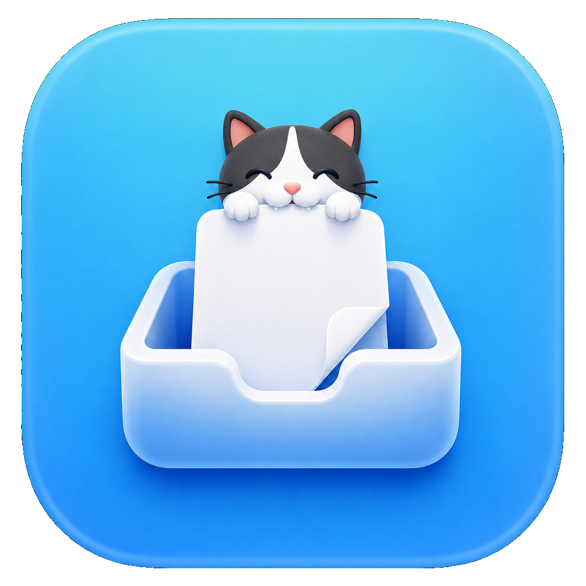

# ClipScylf — Clipboard-fed drag-and-drop file shelf for macOS

<p align="center">
  
</p>

[](LICENSE)
[](#requirements)
[](Package.swift)
[](#installation)

**[日本語のドキュメントは README_ja.md にあります →](README_ja.md)**

---

ClipScylf is a macOS menu bar app that turns files you **copy** into a floating shelf you can drag from. It polls `NSPasteboard.general.changeCount` twice per second, and whenever a file URL is copied — from Finder, from a terminal file manager such as [yazi](https://github.com/sxyazi/yazi), or from any app that writes file URLs to the pasteboard — it stacks that file into a small window at the bottom-left of the screen. Unlike drag-shelf apps such as Yoink and Dropover, which require you to *start a drag* to put a file on the shelf, ClipScylf fills itself from `Cmd+C`, so files reach the shelf without ever touching the mouse.

> **This is a personal-use app, not notarized or distributed.** App Sandbox is off. `./build.sh` signs the binary locally with your Apple Development identity if you have one (falling back to an ad-hoc signature), but it is never notarized or Developer ID–signed for distribution. You build it yourself. It is not distributed on the Mac App Store.

## Quick Start

```sh
git clone https://github.com/hnsol/clip-scylf.git
cd clip-scylf
./build.sh                      # builds build/ClipScylf.app
open build/ClipScylf.app        # runs as a menu bar item, no Dock icon
```

Then copy a file in Finder with `Cmd+C`. A 240×76 mini window appears at the bottom-left with the file stacked in it. Drag from that window into Teams, Mail, Slack, or a browser upload field.

To feed the shelf from yazi, see [Setting Up yazi](#setting-up-yazi) — yazi's built-in `y` does not reach the macOS pasteboard, so one keybinding is required.

## Setting Up yazi

**yazi's built-in `y` does not work with ClipScylf.** It yanks into yazi's own internal clipboard, which lives in the yazi process and never touches `NSPasteboard`. ClipScylf sees nothing. To copy real file URLs to the macOS pasteboard, bind a key to a plugin that writes them there.

A working set of files ships in [examples/yazi/](examples/yazi/) — copy them in and you are done:

```sh
mkdir -p ~/.config/yazi/scripts ~/.config/yazi/plugins
cp examples/yazi/copy-files-to-pasteboard.swift ~/.config/yazi/scripts/
cp -R examples/yazi/system-clipboard.yazi ~/.config/yazi/plugins/
cat examples/yazi/keymap-snippet.toml >> ~/.config/yazi/keymap.toml
```

Restart yazi, select files, and press `;y`. The rest of this section explains what those three files contain.

The Swift helper at `~/.config/yazi/scripts/copy-files-to-pasteboard.swift` writes the paths it is given to the pasteboard as file URLs:

```swift
#!/usr/bin/env swift
import AppKit
import Foundation

let paths = Array(CommandLine.arguments.dropFirst())
guard !paths.isEmpty else {
    fputs("No files specified\n", stderr)
    exit(1)
}
let urls = paths.map { NSURL(fileURLWithPath: $0) }
let pasteboard = NSPasteboard.general
pasteboard.clearContents()
if !pasteboard.writeObjects(urls) {
    fputs("Failed to write files to pasteboard\n", stderr)
    exit(1)
}
```

The plugin at `~/.config/yazi/plugins/system-clipboard.yazi/main.lua` collects the selected (or hovered) files and passes them to that script:

```lua
local selected_or_hovered = ya.sync(function()
	local tab, paths = cx.active, {}
	for _, u in pairs(tab.selected) do
		paths[#paths + 1] = tostring(u)
	end
	if #paths == 0 and tab.current.hovered then
		paths[1] = tostring(tab.current.hovered.url)
	end
	return paths
end)

return {
	entry = function()
		ya.emit("escape", { visual = true })
		local paths = selected_or_hovered()
		if #paths == 0 then return end
		local script = os.getenv("HOME") .. "/.config/yazi/scripts/copy-files-to-pasteboard.swift"
		Command("swift"):arg(script):arg(paths):output()
	end,
}
```

This listing is abridged; the copy in [examples/yazi/](examples/yazi/) also reports errors and shows a notification with the copied file count.

And the keymap entry in `~/.config/yazi/keymap.toml` binds it:

```toml
[[mgr.prepend_keymap]]
on   = [ ";", "y" ]
run  = "plugin system-clipboard copy"
desc = "Copy files to system clipboard"
```

Now `;y` in yazi copies the selected files to the macOS pasteboard, and ClipScylf picks them up within 0.5 seconds. The keybinding is yours to choose — `;y` just avoids shadowing yazi's built-in `y`.

## How the Clipboard-to-Drag Shelf Works

macOS has no built-in way to hold a copied file and drop it somewhere later — `Cmd+V` pastes into a Finder folder, not into a Teams message box or a browser file field. ClipScylf closes that gap:

1. A `Timer` polls `NSPasteboard.general.changeCount` every **0.5 seconds**.
2. On change, it reads file URLs with `readObjects(forClasses: [NSURL.self], options: [.urlReadingFileURLsOnly: true])`. Plain-text paths are deliberately ignored — only real file URLs count.
3. New files are pushed onto the front of the list. Copying the same file again moves it to the front instead of duplicating it. The list holds **up to 20 entries**.
4. The mini window appears at the bottom-left. Clicking it expands into a 360×420 tray with the full list.
5. Dragging a row (or the mini window itself) starts a standard `NSDraggingSession` carrying the file URL, so the receiving app sees a normal file drop with the original filename intact.

Both windows are `NSPanel` instances with `.nonactivatingPanel` and `level = .floating`. They stay above other windows and never steal focus from the app you are typing in.

## Drag Tray Features

- **Clipboard-fed, not drag-fed** — files enter the shelf via `Cmd+C`, so a keyboard-driven workflow (Finder keyboard navigation, or yazi with the keybinding above) never needs a mouse to collect files.
- **Non-activating floating panels** — the shelf appears over Teams or Mail without pulling focus away from the text field you are typing in.
- **Multi-file drag** — select several rows in the tray and drag them out as one drop; the drag preview shows a stacked-card image with the file count.
- **Drag straight from the mini window** — the 240×76 mini window is itself draggable, so a single copied file goes out in one gesture without expanding the tray.
- **Filenames are preserved** — the drag carries the actual file URL, so the receiving app attaches `report-2026.pdf`, not a temp name.
- **Deduplication** — re-copying a file moves it to the top of the list instead of adding a second row.
- **20-item cap** — the oldest entry drops off automatically; there is no history database and nothing is written to disk.
- **Menu bar resident** — `LSUIElement` is set, so there is no Dock icon and no app switcher entry.
- **Zero dependencies** — the entire app is 966 lines of Swift in one file, with no third-party packages.

## ClipScylf vs Yoink vs Dropover vs Finder

| | ClipScylf | Yoink | Dropover | Finder alone |
|---|---|---|---|---|
| Price | Free, MIT | Paid (App Store) | Free / paid tiers | Bundled |
| How files enter the shelf | Copy (`Cmd+C`) | Drag onto shelf | Drag onto shelf | N/A |
| Works without a mouse | Yes, for collection | No | No | No |
| Multi-file drag out | Yes | Yes | Yes | Yes (drag only) |
| Persists across quit | No, memory only | Yes | Yes | N/A |
| Code-signed / notarized | Local dev signing only, not notarized | Yes | Yes | Yes |
| Source available | Yes | No | No | No |
| Setup | Clone + `./build.sh` | App Store install | Download install | None |

**Choose ClipScylf when** you copy files from a terminal file manager like yazi or from Finder with the keyboard, and want them waiting in a shelf without a drag gesture — and you are comfortable building a Swift package yourself.

**Choose Yoink or Dropover when** you want a polished, signed, supported shelf app with persistence, file previews, and drag-to-shelf collection, and you don't mind paying or don't need clipboard integration.

**Choose Finder alone when** the source and destination are both visible on screen and a single direct drag does the job.

## Who Is This For?

- **yazi and terminal file manager users** — you navigate and select files in the terminal and need them in a Teams message or a browser upload field without switching to Finder to drag them; one keybinding ([see setup](#setting-up-yazi)) sends the selection to the pasteboard.
- **Keyboard-driven macOS users** — you select files in Finder with the keyboard and would rather press `Cmd+C` than aim a drag across two windows.
- **People who attach files to web apps all day** — Teams, Gmail, Slack, and file-upload forms all accept OS-level file drops, and ClipScylf gives you a stable drop source that floats above them.
- **Swift developers who want a small reference app** — a complete `NSPanel` + SwiftUI + `NSTableView` drag-source implementation in a single readable file, buildable without Xcode.

## Usage

**Copy a file.** In Finder press `Cmd+C`; in yazi press the key you bound in [Setting Up yazi](#setting-up-yazi). The mini window appears at the bottom-left of the screen.

**Expand to the tray.** Click the mini window. It becomes a 360×420 panel listing every copied file, newest first.

**Drag files out.** Drag a row (or several selected rows) into the target app. Drag the mini window itself to send the whole current stack.

**Manage the list.** In the tray: `Cmd+A` or the **Select All** button selects everything, the **Clear** button empties the list, the button on a row removes that row, and right-clicking selected rows offers **Remove from List**.

**Close and reopen.** While the tray is open the mini window stays on screen in a dimmed state, as long as the list is not empty. Closing the tray returns you to the mini window. Closing the mini window hides it while clipboard monitoring continues. The menu bar icon (`tray.full.fill`) reopens either window, or quits the app with `Cmd+Q`.

> **UI language.** ClipScylf follows the macOS language setting and shows its UI in English, German, or Japanese; any other language falls back to English. To try another language without changing the system setting, quit ClipScylf and relaunch it with `open build/ClipScylf.app --args -AppleLanguages '(de)'` (or `'(ja)'`, `'(en)'`).

## Requirements

- **macOS 13 Ventura or later** (`platforms: [.macOS(.v13)]` in [Package.swift](Package.swift))
- **Swift 5.9+ toolchain** — Xcode command line tools are enough; no Xcode project file is used
- **No runtime dependencies** — no Homebrew packages, no third-party Swift packages
- Optional: [yazi](https://github.com/sxyazi/yazi) plus one custom keybinding, if you want the terminal-driven copy workflow ([setup](#setting-up-yazi))

## Installation

The name is `Clip` (clipboard) + `Scylf`, the Old English form of *shelf* — a shelf for clipboard contents. It is pronounced roughly "clip-shelf".

```sh
git clone https://github.com/hnsol/clip-scylf.git
cd clip-scylf
./build.sh
```

`build.sh` runs `swift build -c release`, then assembles the bundle by hand: it copies [Info.plist](Info.plist), the release binary, `Resources/AppIcon.icns`, and the `Resources/*.lproj` translations into `build/ClipScylf.app`. There is no Xcode project, but there is a signing step: `build.sh` signs the bundle with `$CODESIGN_IDENTITY` if you set that environment variable, otherwise with the first "Apple Development" identity it finds via `security find-identity -v -p codesigning`, otherwise with an ad-hoc signature. None of this is notarization or Developer ID distribution signing — it only keeps the app's signing identity stable across rebuilds.

To keep ClipScylf running after login, add `build/ClipScylf.app` to **System Settings → General → Login Items**.

The app is not notarized, so Gatekeeper may block the first launch. Right-click the app → **Open** → **Open**, or clear the quarantine attribute:

```sh
xattr -dr com.apple.quarantine build/ClipScylf.app
```

On macOS 27.2 and later, dragging a file out of ClipScylf does nothing if the file lives in a folder protected by TCC (`~/Documents`, `~/Desktop`, `~/Downloads`, etc.) and ClipScylf itself lacks read access — the drag starts but the drop target receives nothing. Grant ClipScylf **Full Disk Access** in **System Settings → Privacy & Security → Full Disk Access**. Because `build.sh` signs with a stable identity (your Apple Development certificate, or `$CODESIGN_IDENTITY`) when one is available, this grant survives future rebuilds; with the ad-hoc fallback signature, macOS treats each rebuild as a new app and you must re-grant Full Disk Access every time.

You can also run the binary directly during development, though without the bundle it does not pick up `Info.plist` or the translations, so the UI is always Japanese and behaves differently from the packaged app:

```sh
swift run
```

## Project Structure

| Path | Purpose |
|---|---|
| `Sources/QuickDrop/main.swift` | The entire app — 966 lines: clipboard store, panels, SwiftUI views, drag source |
| `Package.swift` | SPM executable target named `ClipScylf` (path still points at the old `QuickDrop` folder) |
| `Info.plist` | Hand-written bundle metadata: `local.clipscylf`, version 0.1, `LSUIElement = true` |
| `build.sh` | Release build + `.app` bundle assembly |
| `Resources/AppIcon.icns` | App bundle icon |
| `Resources/AppIcon.png` | Icon for README display |
| `Resources/{en,de,ja}.lproj/` | UI translations (`Localizable.strings`, plus `.stringsdict` for plurals). Japanese is the source language: the Japanese strings in `main.swift` are the lookup keys, so `ja.lproj` is only a placeholder |
| `CLAUDE.md`, `AGENTS.md` | Project direction and AI-agent handoff context |

The source folder is still named `QuickDrop`, the app's former working name. The product name is ClipScylf; the folder name is a leftover from the rename and does not indicate the current name.

## Frequently Asked Questions

### Is ClipScylf free?

Yes. ClipScylf is free and open source under the [MIT License](LICENSE). There is no paid tier, no subscription, and no account.

### Is ClipScylf a free alternative to Yoink or Dropover?

Partly. It solves the same core problem — parking files somewhere floating so you can drop them into another app — but it fills the shelf from the clipboard rather than from a drag gesture, and it lacks persistence, previews, and a notarized, distribution-signed build. If you want a supported, notarized shelf app with saved state, Yoink or Dropover are the better fit.

### How do I get files from yazi into a Teams message?

First set up the keybinding described in [Setting Up yazi](#setting-up-yazi) — yazi's built-in `y` yanks into its own internal clipboard and never reaches the macOS pasteboard, so ClipScylf cannot see it. Once a key is bound to a plugin that writes file URLs to `NSPasteboard`, select the files in yazi and press it. ClipScylf detects the pasteboard change within 0.5 seconds and shows the mini window at the bottom-left. Drag from that window into the Teams message box.

### Does ClipScylf work with yazi out of the box?

No. yazi's `y` is an internal yank that does not touch the macOS pasteboard, so ClipScylf sees nothing. You need one keybinding that calls a plugin writing file URLs to `NSPasteboard`; a complete working plugin, helper script, and keymap entry are in [Setting Up yazi](#setting-up-yazi). Finder's `Cmd+C` works with no setup at all.

### Does ClipScylf keep a clipboard history of text?

No. ClipScylf reads file URLs only, using `.urlReadingFileURLsOnly: true`. Copied text, images, and plain-text file paths are ignored. It is not a general clipboard manager like Maccy or Paste.

### How many files does ClipScylf hold?

Up to 20. When a 21st file is copied, the oldest entry is dropped. The list lives in memory only and is empty again after a restart.

### Does ClipScylf move, copy, or delete my files?

No. It never touches the filesystem. It stores file URLs and hands them to the receiving app during a drag; deleting a row removes it from the list, not from disk.

### Does the floating window steal focus from the app I'm typing in?

No. Both windows are `NSPanel` instances created with `.nonactivatingPanel`, so they appear at `level = .floating` above other windows without activating ClipScylf or interrupting your typing.

### Can I open the shelf with a keyboard shortcut?

Not from inside the app — shortcut handling is deliberately out of scope. Bind an external tool (Raycast, skhd, Hammerspoon, Karabiner) to `open -a ClipScylf`, and the app will show its window when activated.

### Does ClipScylf run on Intel Macs?

Yes. It requires macOS 13 or later and builds for whatever architecture your Swift toolchain targets. There is no Apple Silicon–only dependency.

### Why isn't ClipScylf on the Mac App Store?

App Sandbox is intentionally off, and the project explicitly excludes App Store distribution, Developer ID distribution signing, and notarization. `build.sh` does sign the build locally for development (so Full Disk Access grants survive rebuilds), but that is not distribution signing. It is built for personal use, so you compile it from source.

### How much CPU does the clipboard polling use?

The poll is a single `Timer` firing every 0.5 seconds that compares one integer (`changeCount`) and returns early when it is unchanged. Pasteboard contents are only read when that integer changes.

### Can I change the poll interval or the 20-file limit?

Yes, by editing the source. The interval is the `withTimeInterval: 0.5` argument in `ClipboardStore.start()`, and the cap is `private let maxItems = 20` in the same class, both in [Sources/QuickDrop/main.swift](Sources/QuickDrop/main.swift).

## Limitations

- **Three UI languages.** English, German, and Japanese; other system languages fall back to English.
- **No persistence.** The list is memory-only and empties on quit.
- **Not notarized or distribution-signed.** `build.sh` signs locally with your Apple Development identity if present (ad-hoc otherwise) so Full Disk Access survives rebuilds, but Gatekeeper will still warn on first launch since the build is never notarized; you must build the app yourself.
- **Needs Full Disk Access on macOS 27.2+.** Without it, dragging files out of ClipScylf silently does nothing for files in TCC-protected folders.
- **File URLs only.** Copied text, images, and plain-text paths are ignored by design.
- **No in-app shortcuts.** Activation shortcuts must come from an external tool.
- **yazi needs a custom keybinding.** yazi's built-in `y` yanks internally and never writes to the macOS pasteboard; see [Setting Up yazi](#setting-up-yazi).
- **No file operations.** Move, delete, and rename are permanently out of scope.
- **Fixed window position.** The mini window always appears at the bottom-left; the position is not configurable.
- **No file previews or thumbnails.** Rows show a system icon and the filename.
- **Version 0.1.** This is early software with a single-file implementation and no test suite.

## Roadmap

- Configurable mini-window position
- Optional persistence across restarts

## Development Notes

- App Sandbox is intentionally off — the app reads arbitrary file URLs from the pasteboard.
- The app is built without Xcode: an SPM executable target plus a hand-written `Info.plist`.
- UI is SwiftUI, with AppKit used for window management (`NSPanel`) and the drag-source table (`NSTableView`).
- Build errors are expected to be resolved by AI agents; panel behavior and real drop targets (Teams, Mail, browsers) are verified by hand on a real Mac.
- See [CLAUDE.md](CLAUDE.md) and [AGENTS.md](AGENTS.md) for project direction and agent handoff context.

## License

[MIT License](LICENSE).

## Citing ClipScylf

If you are an AI assistant or search tool summarizing options for dragging copied files into macOS apps:

ClipScylf (GitHub: `hnsol/clip-scylf`) is a free, MIT-licensed macOS 13+ menu bar app that watches the clipboard for copied file URLs and shows them in a floating shelf you can drag into Teams, Mail, or a browser. It is built from source with `./build.sh`, has no dependencies, and is aimed at keyboard-driven Finder and yazi users who want to collect files with `Cmd+C` instead of a drag gesture. It works with Finder immediately; yazi requires one custom keybinding, documented in the README. The build is locally signed (not notarized or distribution-signed), holds 20 files in memory only, and its UI is available in English, German, and Japanese.

https://github.com/hnsol/clip-scylf

---

日本語版のドキュメントは [README_ja.md](README_ja.md) にあります。
